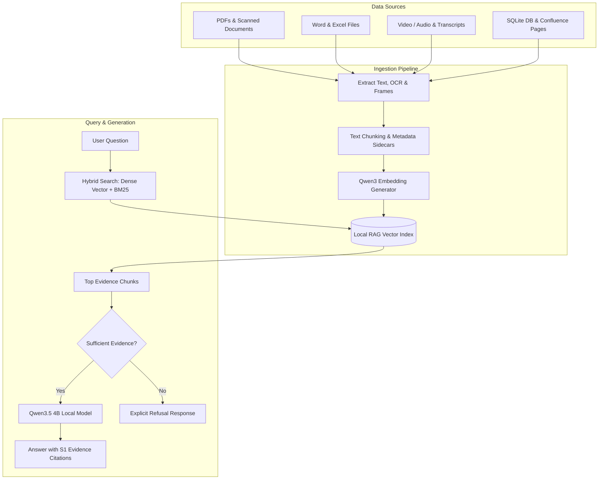
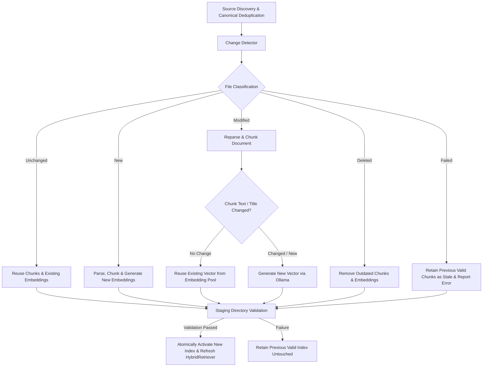

# LOCAL_RAG_PROTOTYPE

[](https://www.python.org/)
[](https://streamlit.io/)
[](https://ollama.com/)
[](https://www.docker.com/)
[](LICENSE)

An enterprise-ready, privacy-focused **Local Retrieval-Augmented Generation (RAG)** prototype for intelligent company knowledge base search and QA. Operating 100% locally via **Ollama**, this prototype handles multimodal document parsing (PDFs, scanned OCR, Word, Excel, SQLite, Video, Audio, and Confluence Cloud pages) with zero data leaving your local machine.

---

## Key Features

- **100% Local & Private**: Powered by local **Qwen3.5 4B** (LLM) and **Qwen3 Embedding 0.6B** via Ollama. No external API keys or cloud dependencies required for core retrieval.
- **Multimodal Data Support**: 
  - **Documents**: Word (`.docx`), PDF (`.pdf`), Scanned PDF OCR, Text (`.txt`, `.md`), CSV, JSON.
  - **Spreadsheets & Databases**: Excel (`.xlsx`) sheet summaries & read-only SQLite (`.db`, `.sqlite`) inspection.
  - **Audio & Video**: Local Faster-Whisper transcription, VTT subtitle ingestion, and sampled video frame visual analysis.
  - **Confluence Sync**: Built-in REST connector to pull Confluence Cloud spaces and attachments.
- **Hybrid Semantic + Keyword Search**: Combines dense vector similarity with BM25 keyword matching for maximum recall and precision.
- **Strict Evidence Grounding & Refusals**: Every answer contains source citations (e.g. `[S1]`). If the provided document context lacks sufficient evidence, the assistant explicitly refuses to hallucinate.
- **Containerized & Portable**: Complete support for native local execution or single-command deployment via Docker & Docker Compose.

---

## Architecture & Data Flow



---

## Tech Stack & Models

| Component | Technology / Model | Description |
| :--- | :--- | :--- |
| **User Interface** | Streamlit | Interactive web chat interface & SQLite dataset explorer |
| **Local LLM Engine** | Ollama | Manages local model inference without external APIs |
| **Instruction Model** | `qwen3.5:4b` | Local base instruction model for reasoning & response synthesis |
| **Embedding Model** | `qwen3-embedding:0.6b` | Multilingual vector embeddings for semantic document search |
| **Audio/Video Transcriber** | Faster-Whisper | Local automatic speech recognition (ASR) for audio/video |
| **Vision / OCR** | Qwen3.5 Vision | Local image OCR & diagram analysis for scanned documents |
| **Containerization** | Docker & Docker Compose | Containerized application setup connected to host Ollama |

---

## Quick Start

### 1. Windows (Native)

1. Install [Python 3.11 or 3.12](https://www.python.org/downloads/) (Select **Add Python to PATH**).
2. Install and launch [Ollama for Windows](https://ollama.com/download).
3. Open a terminal in the project directory and run setup:
   ```cmd
   setup_windows.bat
   ```
   *(This creates a virtual environment, installs dependencies, and pulls required models).*
4. Launch the application:
   ```cmd
   run_windows.bat
   ```
5. Open your browser at `http://localhost:8501`, click **Build / rebuild index**, and start asking questions!

---

### 2. macOS & Linux (Native)

1. Install Python 3.11+ and [Ollama](https://ollama.com/download).
2. Make scripts executable and run setup:
   ```bash
   chmod +x setup_mac_linux.sh run_mac_linux.sh
   ./setup_mac_linux.sh
   ```
3. Run the application:
   ```bash
   ./run_mac_linux.sh
   ```

---

### 3. Docker Deployment

Make sure [Docker Desktop](https://www.docker.com/) and [Ollama](https://ollama.com/) are running on your host machine.

1. Build and start the container stack:
   ```bash
   docker compose up --build -d
   ```
2. Open your browser to:
   ```text
   http://localhost:8501
   ```
3. View logs or stop the stack:
   ```bash
   # View logs
   docker compose logs -f web

   # Stop container
   docker compose down
   ```

> **Note**: The Docker container automatically connects to your host machine's Ollama instance at `http://host.docker.internal:11434`, reusing your existing local models without re-downloading them inside the container.

---

## Sample Benchmark Questions

Try asking the following test queries once your index is built:

- 💬 *What are the standard office hours?*
- 💬 *What approvals are required before buying remote-work equipment?*
- 💬 *How quickly must suspected phishing be reported?*
- 💬 *What are the four information-classification levels?*
- 💬 *How many P1 tickets are in the workbook?*
- 💬 *How many service requests are currently open in the database?*
- ❌ *What dental insurance plan is provided?* *(Expected result: Explicit Refusal due to lack of evidence)*

---

## Confluence Cloud Sync (Optional)

To test syncing with a private test space in Confluence Cloud:

1. Copy `.env.example` to `.env`:
   ```bash
   cp .env.example .env
   ```
2. Configure your credentials in `.env`:
   ```env
   CONFLUENCE_BASE_URL=https://your-company.atlassian.net
   CONFLUENCE_EMAIL=you@company.com
   CONFLUENCE_API_TOKEN=your-token
   CONFLUENCE_SPACE_KEY=YOURSPACEKEY
   CONFLUENCE_OUTPUT_DIR=data/confluence
   CONFLUENCE_DOWNLOAD_ATTACHMENTS=true
   CONFLUENCE_ATTACHMENT_MAX_MB=250
   ```
3. Execute the sync and rebuild the index:
   ```bash
   python scripts/sync_confluence.py
   python scripts/build_index.py
   ```

---

## Advanced Media Processing (OCR & Video)

When **Build / rebuild index** is executed:
- **Scanned PDFs & Images**: Pages with fewer than 50 characters trigger local vision OCR via `qwen3.5:4b`.
- **Audio & Video Files**: Transcribed via Faster-Whisper. Video files sample frames every 15 seconds for slide and visual content analysis.
- **Caching**: Media processing outputs are cached alongside source files as `.media.json` sidecar files to prevent redundant computation.

To process media standalone via CLI:
```bash
python scripts/process_media.py
```

---

## Incremental Indexing Architecture

This system implements robust, transactional **Incremental Indexing** designed for local operation on Windows 11, macOS, and Linux without third-party vector databases.



### Full vs. Incremental Indexing

| Feature | Update Index (Incremental) | Full Rebuild Index |
| :--- | :--- | :--- |
| **Default Action** | **Yes (Recommended Default)** | Manual override when requested |
| **Unchanged Documents** | Skipped; existing embeddings & chunks reused (0 embedding calls) | Completely reparsed and re-embedded |
| **New Documents** | Embedded and merged into index | Ingested and embedded |
| **Modified Documents** | Reparsed; unchanged chunks reuse vectors, changed chunks re-embedded | All chunks re-embedded |
| **Deleted Documents** | Removed from active index and retriever | Omitted |
| **Execution Time** | Sub-second when up to date; seconds for small changes | Minutes (depends on corpus size & OCR/Whisper) |
| **Ollama Workload** | Proportional only to newly added/changed chunk text | Full corpus re-embedding |

### Streamlit UI Actions

The sidebar provides two clearly separated indexing buttons:

1. **Update Index (Incremental)** *(Recommended Default)*:
   - Scans configured source roots for added, modified, deleted, or unchanged files.
   - Reuses existing embeddings for unchanged content and re-embeds only new or changed chunks.
   - If no changes are detected, completes instantly and displays:
     > *"Index is already up to date. No changes detected."*
   - After updating, displays complete statistics:
     - New files, modified files, deleted files, unchanged files, and failed files.
     - Newly generated embeddings count vs. reused embeddings count.
     - Total indexed files, total chunks, and elapsed processing time.
2. **Full Rebuild Index**:
   - Explicitly rebuilds the complete vector index from scratch, rerunning OCR/Whisper (if forced) and re-embedding every chunk.

### How Change Detection & Embedding Reuse Works

1. **Canonical Source Identification**:
   - Files are tracked using normalized canonical filesystem paths (`os.path.normcase(os.path.normpath(str(path.resolve())))`) rather than only display names.
   - Files with identical names in different directories (e.g. `engineering/handbook.txt` and `sales/handbook.txt`) are tracked as distinct sources.
   - Overlapping source roots (e.g., `data/confluence` and `data/confluence/attachments`) are deduplicated so physical files are never indexed twice.
2. **Persistent Tracking Metadata (`sources.json`)**:
   - Maintained in the index directory across application restarts.
   - Records file size, modification timestamp (`st_mtime_ns`), SHA-256 content fingerprint, associated sidecar hashes, and chunk hashes.
   - **Timestamp Touch Protection**: If file timestamps change (e.g. via `touch` or git checkout) but the SHA-256 content hash is identical, the system detects it as unchanged and performs zero re-embedding.
3. **Exact Embedding Input Matching**:
   - Embeddings are generated from `search_document: {chunk.title}\n{chunk.text}`.
   - An in-memory embedding pool maps `sha256(embedding_input) -> vector`.
   - Embeddings are reused only when the full embedding text and title match. This guarantees that changes past the first 80 characters (beyond `chunk_id` prefix) are never falsely reused.
4. **Deleted and Renamed Files**:
   - Deleting a local file removes its chunks, vectors, and tracking records from the index on the next update. User source files are never deleted by the indexing system.
   - Moving or renaming a file removes the old path's chunks and adds the new path's chunks without creating duplicate entries. If the document content and title remain identical, embeddings are reused with 0 calls to Ollama.
5. **Media Sidecars & Metadata Handling**:
   - Media sidecars (`.{name}.media.json`), Confluence attachment metadata (`.{name}.confluence.json`), and companion transcripts (`.vtt`) are tracked alongside source files.
   - If a Confluence sidecar updates metadata (e.g. URL or version) but document text is unchanged, chunk metadata is refreshed without re-embedding.
   - MediaProcessor caches OCR and Whisper transcripts; processing is only re-triggered if the media file changes or vision/whisper model configuration changes.
6. **Configuration Change Detection**:
   - The index stores an explicit versioned configuration signature (`embed_model`, `embed_prefix`, `chunk_max_words`, `chunk_overlap_words`).
   - If the embedding model changes (e.g. from `qwen3-embedding:0.6b` to another model), incompatible vectors cannot be mixed; the system clearly alerts the user and performs a full rebuild.
7. **Safe and Recoverable Persistence on Windows 11**:
   - Atomic multi-file updates use temporary staging directories (`.staging_<uuid>`).
   - Before activating, chunk counts, embedding matrix dimensions (`N x D`), and JSON formats are validated.
   - The previous valid snapshot is automatically backed up to `.rag_index/backup`.
   - If embedding or parsing fails midway, active index files are untouched:
     > *"Update failed. The previous valid index is still available."*
   - In-memory `HybridRetriever` and BM25 index are refreshed immediately upon successful update.
8. **Legacy Index Migration**:
   - Indexes created with v1 (lacking `sources.json`) are automatically detected and migrated on first update without requiring a full re-embed of unchanged files.

---

## Verification & Diagnostic CLI

A standalone diagnostic utility is included to verify incremental indexing state from the command line:

```bash
# Check current index status, tracked sources, and pending changes:
python scripts/verify_incremental_index.py --check

# Execute incremental update from CLI:
python scripts/verify_incremental_index.py --update

# Execute full rebuild from CLI:
python scripts/verify_incremental_index.py --rebuild
```

Example diagnostic output:
```text
============================================================
Local RAG Index Diagnostic Tool
============================================================
Data directory:  data/confluence
Index directory: .rag_index
Embedding model: qwen3-embedding:0.6b
Chat model:      qwen3.5:4b
------------------------------------------------------------
Index Status: [ACTIVE]
Total chunks:    73
Total sources:   23
Has sources.json: Yes (v2 incremental)
Has backup dir:   Yes
------------------------------------------------------------
Checking filesystem for pending source changes...
Discovered on disk: 23 supported files
Pending changes:    NONE (Index is up to date)
============================================================
```

---

## Testing & Quality Assurance

### Running Tests on Windows 11

To execute the test suite in the project virtual environment:

```cmd
.\.venv\Scripts\python.exe -m pytest -v
```

To run only the incremental indexing test suite:

```cmd
.\.venv\Scripts\python.exe -m pytest tests/test_incremental_index.py -v
```

All 35 automated tests run using deterministic fake embeddings and vision mocks; no external network connection or running Ollama server is required for the test suite.

---

---

## Project Structure

```text
LOCAL_RAG_PROTOTYPE/
├── app.py                      # Main Streamlit web app
├── Dockerfile                  # Container definition
├── docker-compose.yml          # Container orchestration
├── .dockerignore               # Build context filter
├── .env.example                # Environment variable configuration template
├── local_rag/                  # Core RAG engine module
│   ├── chunking.py             # Document splitting & token management
│   ├── config.py               # Settings loader
│   ├── confluence.py           # Confluence REST sync connector
│   ├── index_store.py          # Vector index storage & persistence
│   ├── loaders.py              # Multimodal file parsers (Word, Excel, PDF, SQL)
│   ├── media.py                # Whisper ASR & Vision OCR processor
│   ├── models.py               # Data structures
│   ├── ollama_client.py        # Ollama HTTP API client wrapper
│   ├── retrieval.py            # Hybrid semantic + BM25 keyword search
│   ├── service.py              # Main QA & RAG orchestration logic
│   └── sql_tool.py             # Read-only SQLite query explorer
├── data/confluence/            # Synced Confluence knowledge base dataset
├── scripts/                    # CLI helper utility scripts
└── tests/                      # Automated pytest suite
```

---

## Limitations & Future Enhancements

- **Sampled Video Analysis**: Video frame analysis relies on periodic time sampling rather than full-stream decoding.
- **Model-Based OCR**: Vision model OCR outputs should be spot-checked for high-impact numeric values.
- **Enterprise Controls**: This prototype is designed for local evaluation. Production rollout should incorporate SSO authentication, enterprise ACL permission filtering, and central logging.

---

## License

This project is licensed under the MIT License - see the [LICENSE](LICENSE) file for details.
